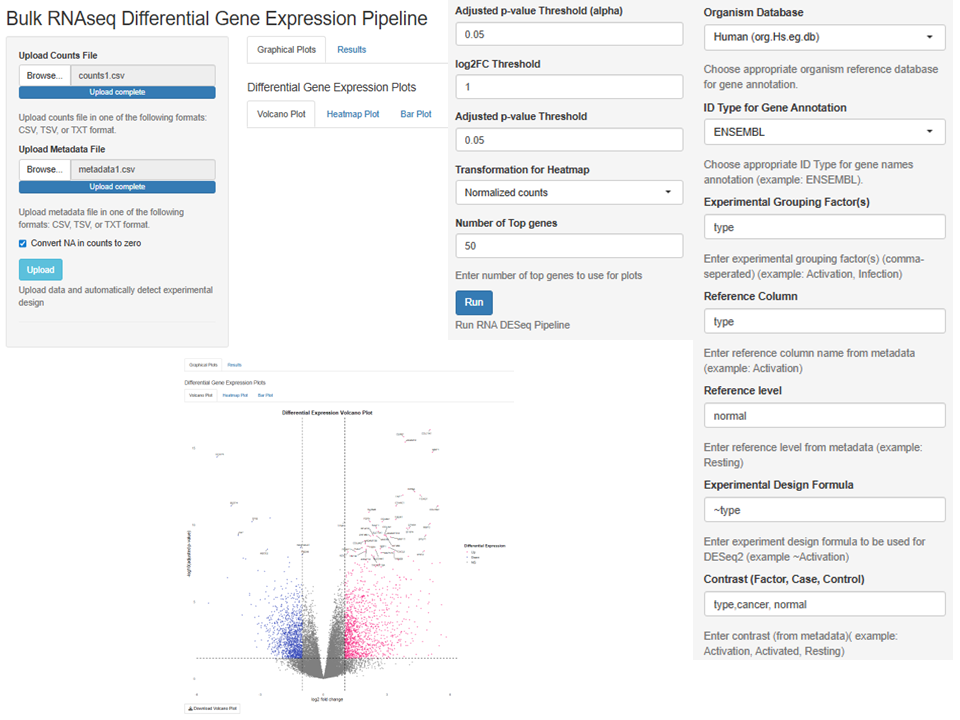

# Bulk RNA-seq Differential Expression Shiny App

An interactive **R Shiny** app that runs a complete bulk RNA-seq differential expression workflow with **DESeq2**, from raw count matrix to annotated results and publication-ready plots, without writing any code.

Upload a count matrix and sample metadata, choose your experimental design, and the app runs DESeq2, annotates genes, and produces volcano plots, heatmaps, and bar plots you can download.



---

## ✨ Features

- **Flexible input:** count matrices and metadata as `.csv`, `.txt`, or `.tsv` (uploads up to 1 GB)
- **Built-in quality checks:** catches missing samples, mismatched sample order, duplicated samples, and duplicated gene IDs, with an option to convert NA counts to zero
- **Custom experimental design:** set your own grouping factors, reference levels, DESeq2 design formula (e.g. `~ Condition`), and contrast
- **Gene annotation** with Bioconductor OrgDb packages for six organisms, or any other annotation package you name:

  | Organism | Package |
  |---|---|
  | Human | `org.Hs.eg.db` |
  | Mouse | `org.Mm.eg.db` |
  | Rat | `org.Rn.eg.db` |
  | Fruit fly | `org.Dm.eg.db` |
  | Zebrafish | `org.Dr.eg.db` |
  | Yeast | `org.Sc.sgd.db` |

- **Supports several gene ID types:** Ensembl, Entrez, gene symbol, or a custom type (e.g. RefSeq, UniProt)
- **Adjustable thresholds:** adjusted p-value (alpha), log2 fold-change cutoff, and number of top genes to display
- **Visualizations:**
  - Volcano plot with labeled top genes (`ggplot2`, `ggrepel`)
  - Heatmap of top DE genes from normalized counts, VST, or rlog (`ComplexHeatmap`)
  - Bar plot of top genes by log2 fold change
- **Downloadable outputs:** all plots, annotated results, raw DESeq2 results, and normalized counts

## 🚀 Getting started

### Requirements
- R (≥ 4.2 recommended) and RStudio
- An internet connection the first time you run it. **The app installs any missing CRAN and Bioconductor packages automatically.**

### Run the app
```r
# 1. Clone or download this repository
# 2. Open app.R in RStudio and click "Run App", or run:
shiny::runApp("app.R")
```

## 📂 Input format

**Count matrix:** genes in rows, samples in columns. The first column holds the gene IDs.

```
GeneID,Sample1,Sample2,Sample3,Sample4
ENSG00000000003,348,609,693,388
ENSG00000000005,0,0,0,0
```

**Metadata:** one row per sample. The first column holds the sample names, which must exactly match the count matrix column names **in the same order**.

```
ID,Condition
Sample1,Normoxia
Sample2,Hypoxia
```

## 🧪 Example datasets

Four ready-to-use datasets are included to try the app:

| Counts | Metadata | Organism | Comparison | Example design |
|---|---|---|---|---|
| `counts.csv` | `meta.csv` | Human | Prostate cancer cell lines (PC3, LNCaP), hypoxia vs. normoxia | `~ Condition` |
| `counts1.csv` | `metadata1.csv` | Human | Cancer vs. normal samples | `~ type` |
| `counts2.csv` | `metadata2.csv` | Human | CD4⁺ T cells: activation state × HIV infection (uninfected / latent) | `~ Activation` |
| `counts3.csv` | `metadata3.csv` | Mouse | Embryonic fibroblasts, knockout vs. wild type | `~ genotype` |

## 🛠️ Built with
R · Shiny · DESeq2 · AnnotationDbi · ComplexHeatmap · ggplot2 · ggrepel · dplyr · DT

## 👩🏾‍🔬 Author
**Elizabeth Etafo**, Ph.D. candidate, Pharmaceutical Sciences, University of Nebraska Medical Center
