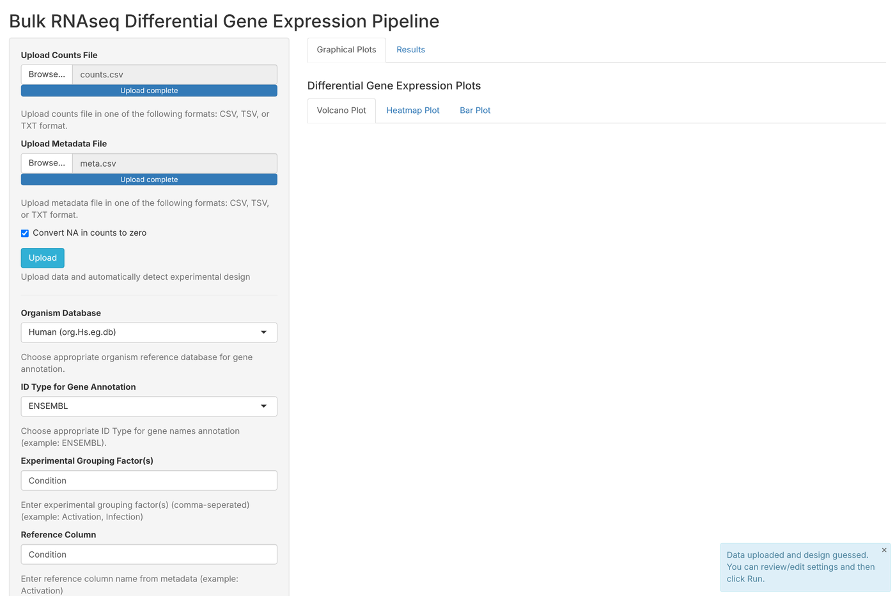
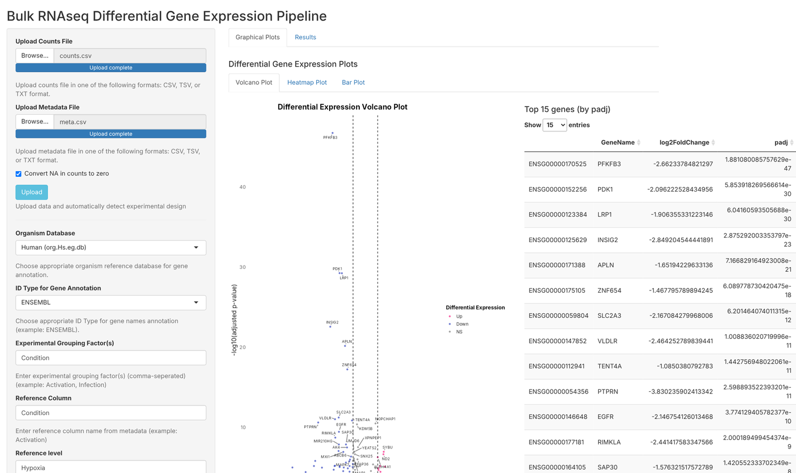
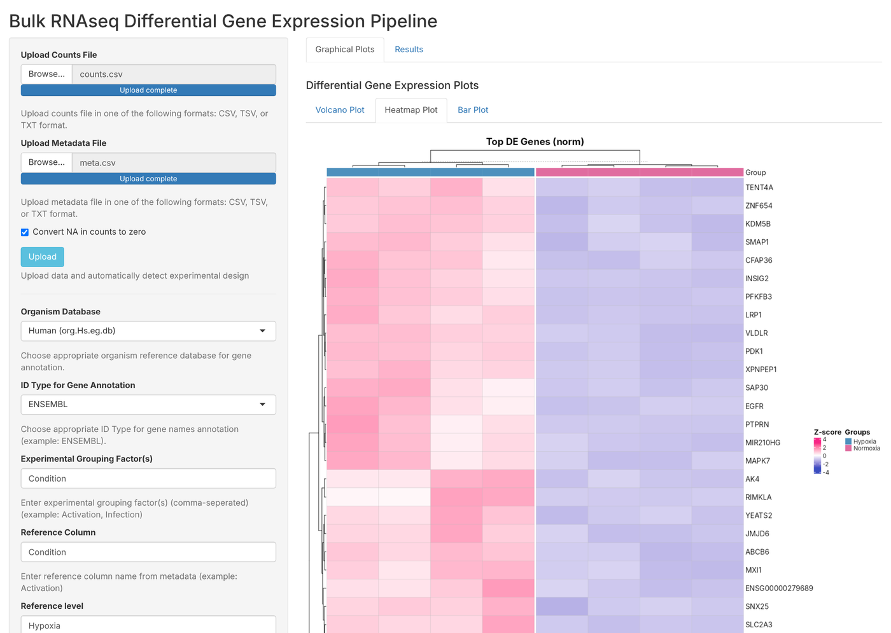
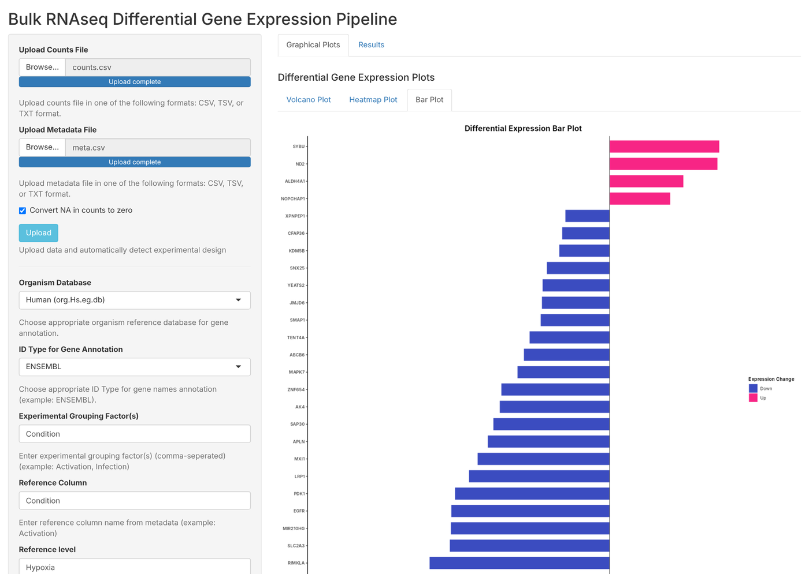
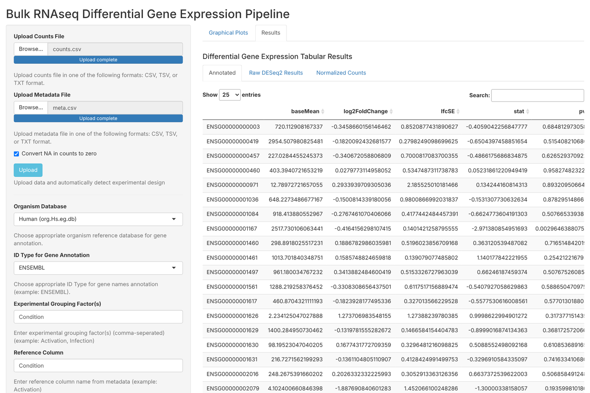

# User guide

## 1. One-time setup
Open RStudio, set the working directory to this repository folder, and run:
```r
source("setup/install_packages.R")
```
Then go to **Session → Restart R**.

> The organism databases (human, mouse, rat, fly, zebrafish, yeast) are large downloads, so the first installation can take 10–20 minutes.

## 2. Start the app
Open `app.R` in RStudio and click **Run App**.

---

## 3. Upload your data and settings



1. **Upload Counts File**: raw counts, genes × samples (CSV, TSV or TXT). See [input format](../example_data/README.md#input-format).
2. **Upload Metadata File**: one row per sample, in the same order as the count columns.
3. Leave **Convert NA in counts to zero** ticked unless you want the app to stop on missing values.
4. Click **Upload**. The app checks that sample names match, then **guesses the design** from the first metadata column that has 2–10 groups, and fills in the settings below.

**Check the guessed settings. The app picks the reference group alphabetically**, which is often the wrong way round:

| Setting | What it means | Example |
|---|---|---|
| **Organism Database** | Used to add gene names | Human (org.Hs.eg.db) |
| **ID Type** | The type of gene IDs in your counts file: `ENSG…` = ENSEMBL, numbers = ENTREZID, gene names = SYMBOL | ENSEMBL |
| **Experimental Grouping Factor(s)** | Metadata column(s) that define groups; separate several with commas | `Condition` |
| **Reference Column / Reference level** | The **control** group that fold changes are measured against | `Condition` / `Normoxia` |
| **Experimental Design Formula** | DESeq2 design; add covariates with `+` | `~Condition` or `~Activation + Infection` |
| **Contrast (Factor, Case, Control)** | The comparison to report: **case first, control last** | `Condition, Hypoxia, Normoxia` |

With contrast `Condition, Hypoxia, Normoxia`, a **positive log2 fold change means higher in Hypoxia**.

**Thresholds**
- **Adjusted p-value threshold (alpha)**: significance cut-off used by DESeq2 (default 0.05).
- **log2FC threshold** and **adjusted p-value threshold** for the plots: which genes are colored as significant on the volcano plot.
- **Transformation for heatmap**: normalized counts, VST or rlog. VST and rlog stabilize the variance of low counts, and VST is a good default.
- **Number of top genes**: how many genes to label and show in the heatmap and bar plot.

5. Click **Run**. DESeq2 usually takes from a few seconds to about a minute.

---

## 4. Plots

**Volcano plot:** every gene, log2 fold change vs. significance, with the top genes labeled. A table of the top 15 genes appears beside it.



**Heatmap:** the top genes across all samples, scaled per gene (z-score) and clustered.



**Bar plot:** the most significant genes (lowest adjusted p-value) shown as bars of their log2 fold change, colored up (pink) or down (blue).



Each plot has a **Download** button.

## 5. Results tables



| Tab | Contents | Download button |
|---|---|---|
| **Annotated** | DESeq2 results + gene names | Download Annotated Results |
| **Raw DESeq2 Results** | DESeq2 results with gene IDs only | Download DESeq2 Results |
| **Normalized Counts** | DESeq2 size-factor-normalized counts | Download Normalized Counts |

Column meanings are in [outputs.md](outputs.md).

---

## Troubleshooting

| Message or problem | Fix |
|---|---|
| *Some samples in counts data missing from metadata* | A count column name has no matching row in the metadata. Check spelling and spaces. |
| *Mismatch in sample order between counts and metadata* | Sort the metadata rows in the same order as the count columns. |
| *NA values in counts* | Tick "Convert NA in counts to zero", or fix the file. |
| *Design formula is not valid* | Start the formula with `~`, for example `~Condition`. |
| *Invalid contrast entered* | Use exactly three items: `factor, case, control`. |
| More groups than expected | Look for typos or trailing spaces in group labels (`Activated` vs `Activated `). |
| Few genes get gene names | The ID type or organism is probably wrong. |
| Package installation fails on first run | Run `setup/install_packages.R` first, then restart R. |
